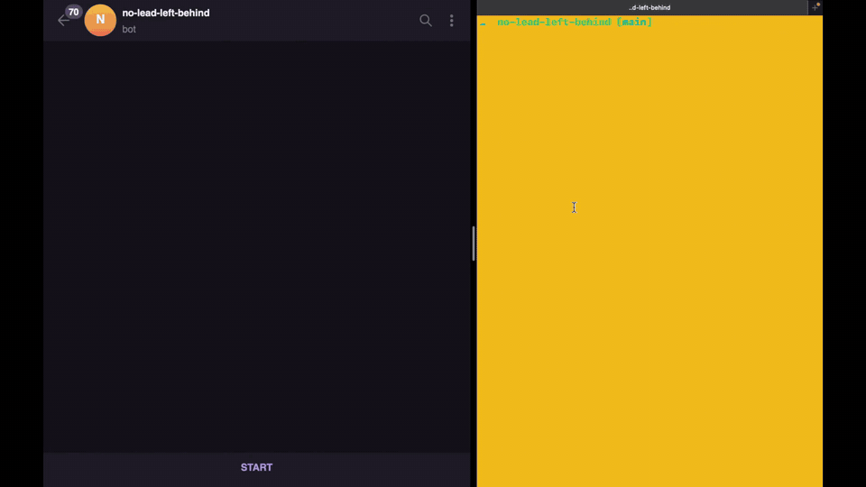
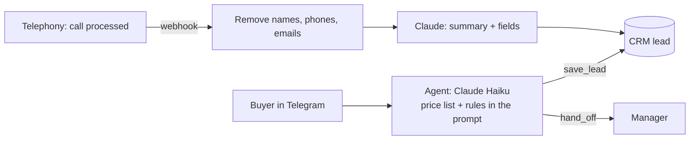

# no-lead-left-behind

One AI-agent deployment, run end to end for a fictional client: a Kyiv residential developer whose buyers wait hours for an answer and whose CRM stays half empty.
The client, its prices and its buyers are simulated; the Claude API calls, the code and the eval numbers are real.



A buyer qualifies in Telegram while the lead fills itself in the CRM; frame by frame in [Demo](#demo).

## What's here

The first written work of an AI deployment, done for Client A:
- [One-page spec](delivery/spec.md): discovery findings, scope, lead fields, when a manager steps in.
- [10 test cases](delivery/test-cases.md): the contract for "good"; the eval runner runs the same 10.
- [Call webhook](app/calls.py), checked on a [sample payload](tests/fixtures/call-processed.json), with personal data removed by [`app/redact.py`](app/redact.py) before any AI sees it.
- [Eval results](evals/results.md): pass rate over 30 runs per case, and cost per conversation.

## The problem

Client A sells flats in two complexes. About 400 buyer conversations a month: 60% in Telegram, 40% by phone.
Discovery found three pains: managers answer Telegram in 2 hours (median) and chats after 19:00 wait until morning; some chats never become a lead; 40% of leads have no budget or rooms, and calls reach the CRM only if a manager remembers.

| | Before (simulated discovery) | After |
|---|---|---|
| First reply in Telegram | 2 hours, median | about 5 seconds, day or night (measured live) |
| Chats that become a lead | unknown | every chat, created by code on the first message |
| Leads with budget and rooms | 60% | the agent asks for them; pilot target 80% |
| Calls noted on the lead | when a manager remembers | every call, summarised, personal data removed |

## How it works



- **Chat.** The agent answers from the price list and the rules only, asks budget, rooms, complex, timing, payment and phone, and saves each answer on the lead.
- **Code, not the model, owns what must never fail:** the "I am an AI" opening, `/manager`, the "Share phone" button, the handoff message. A phone shared by button never reaches Claude.
- **Handoff.** A viewing, a booking, a complaint, a question the price list does not answer, or a request for a person: the lead gets status `handoff` and the reason, and the buyer is told when a manager will write (15 minutes by day, by 12:00 at night).
- **After a call.** The telephony webhook (modelled on Ringostat's "call processed by AI" event) brings the caller's phone and transcript. Code finds the lead by phone, removes names, phones and emails, and only then one Claude call writes the summary and fills the lead.

What Claude receives from the [sample call](tests/fixtures/call-1001.vtt), output of `app/redact.py`:

| Transcript | Sent to Claude |
|---|---|
| Так, Олено, бачу. | Так, [NAME], бачу. |
| Ваш номер +380000000001, правильно? Можна ще 000 000 00 01 як резервний? | Ваш номер [PHONE], правильно? Можна ще [PHONE] як резервний? |
| Надішліть прайс на olena@example.com | Надішліть прайс на [EMAIL] |

The buyer's name is caught in its Ukrainian forms ("Олена", "Олено"), and a phone in any of its formats.

## Demo

Left: the buyer's Telegram, with the live bot. Right: the lead in the CRM (SQLite), refreshed every second. The GIF plays at 1.5x; here is the [full-quality MP4](docs/demo.mp4).
The phone number is blurred in the chat only because this repo is public.

1. `/start`: code sends the AI disclosure ("I am Client A's AI assistant, not a person") and asks what flat the buyer wants.
2. "Хочу гарну" (I want a nice one) is too vague, so the agent asks the budget. "82к" becomes `budget_usd: 82000` on the lead.
3. "2" becomes `rooms: 2`. Asked North or River, the buyer answers "пофіг" (don't care); the agent quotes the price list: River 69,600 USD fits the budget, North 89,900 does not.
4. "Не знаю" (I don't know) when to buy: the agent offers ranges, and "пів року" (half a year) becomes `timing: within 6 months`. "Частинами" (in instalments) becomes `payment: instalments`, with the terms from the price list.
5. The buyer taps "Поділитися номером" (Share phone): the phone lands on the lead without passing through Claude.
6. "Хочу перегляд" (I want a viewing): handoff. The lead gets `status: handoff`, `handoff_reason: viewing`, and code promises a manager within 15 minutes.

## How I'd run this deployment

1. **Week 1, discovery.** Read 50 real chats and calls with two managers; pull the baseline numbers from the CRM ([spec](delivery/spec.md), "What we found").
2. **Week 2, spec and test cases.** One-page spec and [10 test cases](delivery/test-cases.md) signed by the owner; scope in writing; access to CRM, telephony and Telegram.
3. **Week 3, build on a copy.** Agent, CRM fields, call webhook; the eval runner on every change.
4. **Week 4, acceptance.** Every case passes 30 runs; the head of sales tries to break it; 30-minute training for managers.
5. **Weeks 5-6, pilot in waves.** Nights and weekends first (most value, least risk), then all chats. Managers mark each handoff needed or not; every failure becomes a test case.
6. **Week 7, go-live.** Report against the week 1 baseline; then a weekly status and a weekly tuning loop.

## Does it work?

[`evals/run.py`](evals/run.py) runs the 10 test cases against the real API. Code judges actions and data (which tools were called, what is on the lead, the exact price), not wording, which changes from run to run.

One run can pass by luck, so Haiku ran each case 30 times: 293 of 300 passed, 0.24 USD in total.
One run per model then compared cost:

| Model | Passed (one run) | Cost per conversation |
|---|---|---|
| Claude Haiku 5.5 | 10/10 | 0.0008 USD |
| Claude Sonnet 5.5 | 10/10 | 0.0142 USD |

Same pass rate at 1/17 of the cost, so the agent runs on Haiku. Full tables: [`evals/results.md`](evals/results.md).

## One tuning loop

1. **Failure.** In the 30 runs, 7 chats failed, spread over 4 cases.
2. **Cause, read from the saved chats.** All 7 were one fault: the buyer asked about a flat the price list covers, and the agent passed the chat to a manager as a question it cannot answer. One buyer asked "how much is a two-room flat in North?" and got "I am passing you to a manager, who will write to you here by 12:00": the slow answer the agent exists to remove.
3. **Fix.** One sentence in the prompt: questions about flats, prices, areas and rooms are answered from the price list, not passed to a manager.
4. **Check.** The 3 cases that failed most passed 10 of 10 each. A question the price list really cannot answer ("when will the building be finished?") still went to a manager 10 of 10, so the fix did not stop the handoffs that must happen. A fault that hit about 1 chat in 20 can still miss 30 runs by luck about 1 time in 5: likely fixed, not yet proven.

An earlier loop had its own probe: with optional tool fields, the agent saved a payment method the buyer never named in 8 of 10 runs; required fields that may be empty brought it to 0 of 10 ([`evals/strict_probe.py`](evals/strict_probe.py)).

## What breaks at 10x (4,000 conversations a month)

1. **Chats live in memory.** A restart mid-chat forgets it (seen live). Store chats in the database, deleted after 24 idle hours.
2. **The price list in the prompt.** 11 rows fit; 200 rows or daily price changes need a lookup tool, and a test that the agent always uses it.
3. **Managers' 15-minute promise.** Handoffs are a log line today; at 10x they need a queue in the CRM, and the handoff rate becomes the number to watch.
4. **Duplicate leads.** A buyer who never shares a phone and later calls gets a second lead; at 10x managers stop merging by hand, so matching needs more than the phone.
5. **Names said in passing on a call** ("my wife Iryna") are not removed today; more calls, more leaks. Local name detection, so the text still never leaves the client.

Cost is not on the list: about 0.003 USD for a full qualification chat makes 4,000 chats about 12 USD a month (estimate).

## Why plain Python, not n8n

One webhook and one CRM fit in a few tested lines; n8n pays off when a client's team edits many integrations without a developer.

## Limits

- Client A, its numbers and its buyers are simulated; the CRM is SQLite, not Bitrix24; the call payload follows Ringostat's parameter sheet, with the keys it does not document marked simulated.
- No live bot: the demo is a recording.
- Telegram chats reach Claude as the buyer wrote them; the buyer is told up front they are talking to an AI.
- The evals check actions and data, not tone; 30 of 30 means a failure rate under 10%, not zero.

## How it was built

Built with Claude Code, one fresh session per role: a planner writes the spec and tickets, an implementer builds one ticket with tests, and a critic who never saw the plan judges it against the [brief](docs/BRIEF.md); files carry the context, never chat history ([workflow](docs/WORKFLOW.md)). Every decision is one line in the [journal](docs/journal.md).

## Run it

```sh
python -m venv .venv && .venv/bin/pip install -r requirements.txt
cp .env.example .env                 # add ANTHROPIC_API_KEY, TELEGRAM_BOT_TOKEN, TELEGRAM_ALLOWED_IDS
.venv/bin/python -m pytest           # unit and end-to-end tests with a fake Claude
.venv/bin/python -m evals.run        # the 10 test cases on the real API, about 0.01 USD
.venv/bin/python -m app.bot          # the Telegram bot
```
